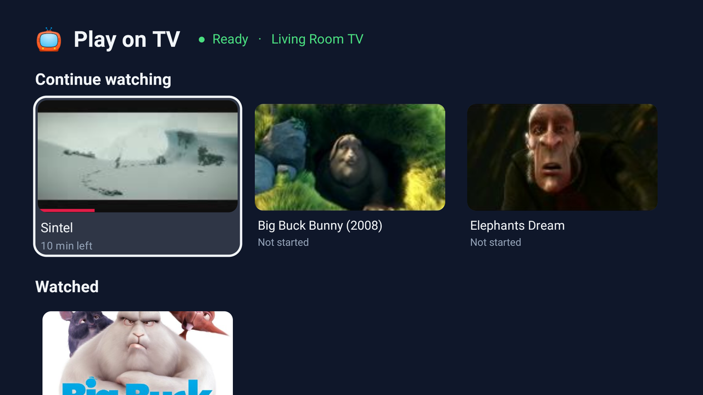
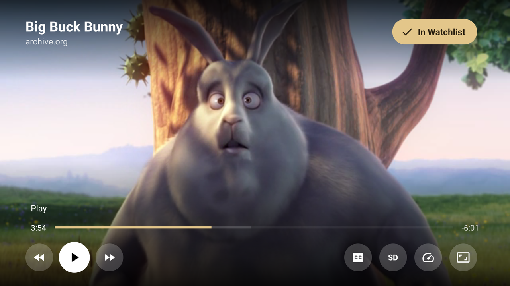
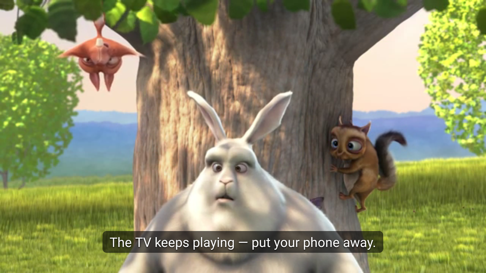
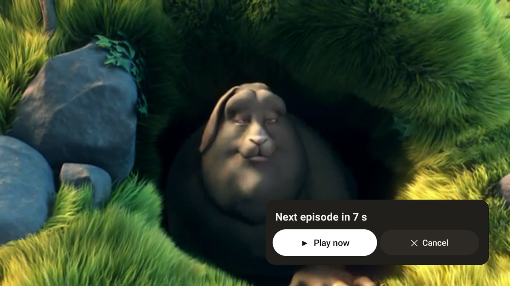
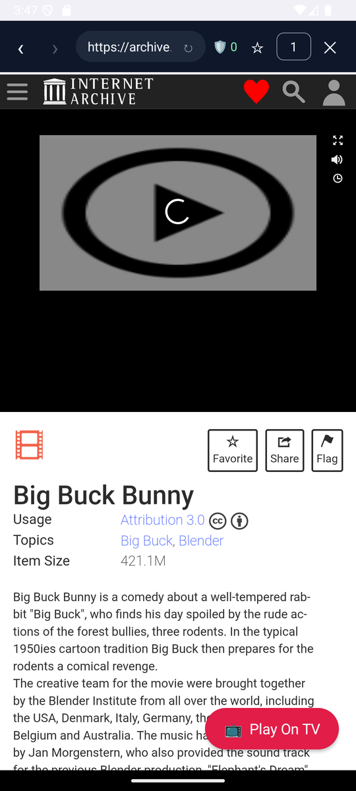
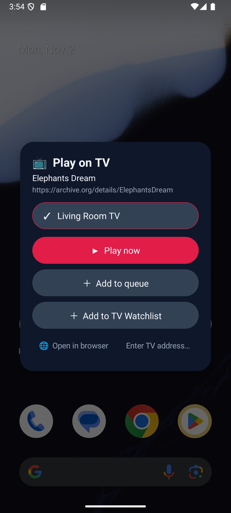
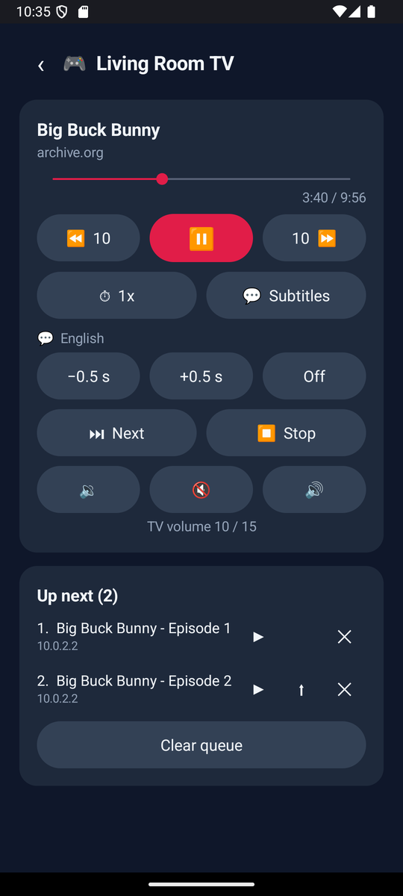
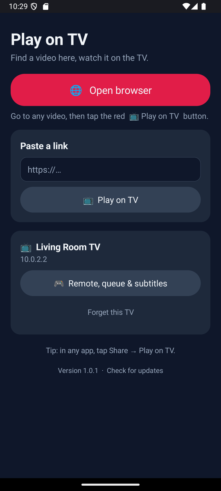

# 📺 Play on TV

> [!NOTE]
> **This app was written entirely by AI.** All of its code, design and this page were generated by
> [Claude](https://claude.ai) (Anthropic) in Claude Code.
> It's a personal project: use it at your own risk.

Send a video from your Android phone to your Android TV, and the TV plays it **by itself** —
you can put your phone away.

  
  

  
  

  
  
  
  

## ⬇ Download
**[PlayOnTV.apk](https://github.com/rafaelsoesanto/play-on-tv-releases/releases/latest/download/PlayOnTV.apk)** — one app for both the TV and the phone (Android 7+).

## How to use
1. Install the APK on your **TV** and your **phone** (same Wi-Fi). Open it once on the TV.
2. On the phone, open **Play on TV → Open browser** and go to a video page.
3. Tap **📺 Play On TV**. The first time, type the code shown on the TV.

You can also use **Share → Play on TV** from other apps.

## What it does
- 🔎 Finds the video on a web page for you
- 📺 **Watchlist** on the TV: *Continue watching* and *Watched*, with posters — just the TV remote, no phone needed
- 📋 Queue, and plays the **next episode** automatically
- ⏯ Resumes where you stopped, best quality by default
- 💬 Subtitles: from the video, the website, or OpenSubtitles
- 🎮 Your phone works as a remote
- 🔖 Bookmarks in the phone's browser
- 🔒 Private: pairing code, encrypted DNS, ad blocking, no history
- ⬆ Updates itself from this page

## Notes
- **Watchlist links can expire.** Most sites keep their episode pages working, but temporary video links
  (for example from apps like Aniyomi) can stop working after a while. Those show *⚠ link may expire*.
  If one doesn't play anymore, send it again from your phone and the Watchlist entry is updated.
- **Power:** on the TV only a tiny receiver waits for your phone (no measurable CPU when idle).
  When you switch to another app, nothing keeps loading; a paused video is freed after 5 minutes and
  continues from the same spot. The TV can go to sleep while a video is paused.
- DRM services (Netflix, Disney+, …) can't be played this way.

---
Screenshots show *Big Buck Bunny*, *Elephants Dream* and *Sintel* (© Blender Foundation, CC BY). Only use the app for content you have the right to watch.
